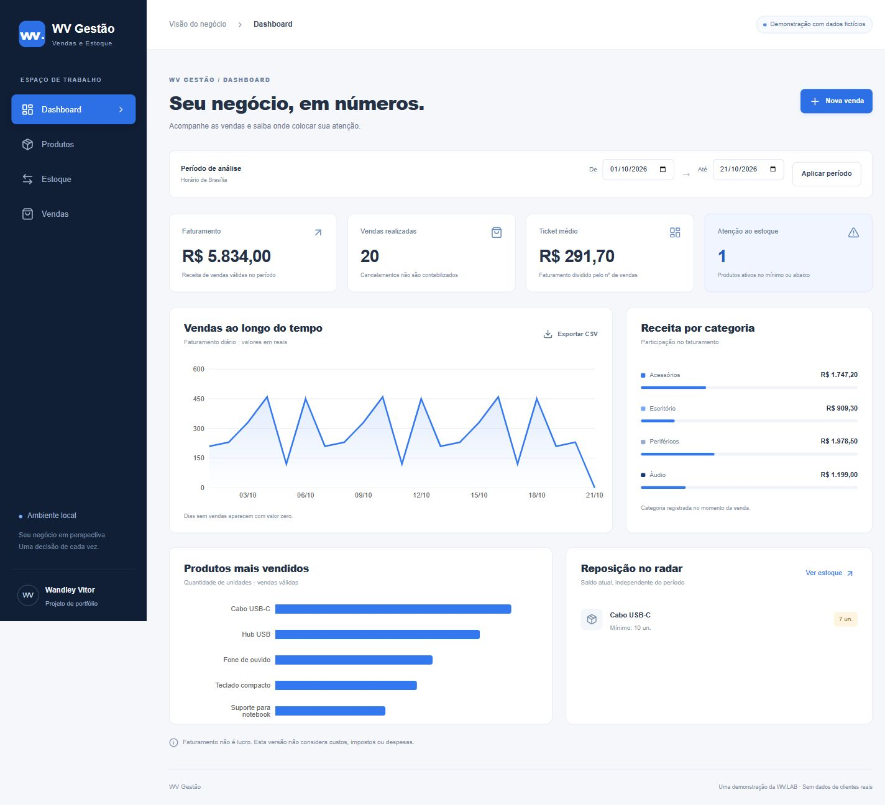

# WV Gestão — Vendas e Estoque

Aplicação de portfólio de **Wandley Vitor**, desenvolvida com assistência de IA. Demonstração local, sem clientes reais, sem pagamentos e sem emissão fiscal.

Para começar pelo conceito, leia [Entenda o projeto](docs/ENTENDA_O_PROJETO.md). A documentação de validação está em [Validação](docs/VALIDACAO.md).



## O problema
Pequenos negócios precisam conferir o que foi vendido, o que ainda está disponível e quais produtos precisam de reposição. O WV Gestão organiza esse fluxo e transforma o histórico de vendas em indicadores. Esta versão não foi utilizada por clientes nem demonstra resultados comerciais reais.

## Funcionalidades
- **Produtos:** cadastro, edição, busca por nome/código e desativação com histórico preservado. Código único, preço e estoque mínimo não negativos.
- **Estoque:** estoque inicial, entradas e saídas com data/motivo. Saldo calculado pelas movimentações, sem edição direta. Não aceita saldo negativo, inclusive em lançamentos retroativos.
- **Vendas:** vários itens, quantidades inteiras positivas, cálculo do total no backend, preço/nome/categoria históricos e baixa atômica de estoque.
- **Cancelamento:** preserva a venda e adiciona devoluções ao histórico. Repetir o pedido não duplica a devolução.
- **Dashboard:** período, faturamento, vendas, ticket médio, ranking por unidades, receita por categoria, evolução diária e alerta de reposição.
- **CSV:** produtos, movimentações, itens de vendas e indicadores. UTF-8 com BOM, separador `;`, dinheiro em centavos inteiros e proteção dos textos contra fórmulas de planilha.

## Tecnologias e estrutura

```text
backend/
  app/db.py          conexão e transações de escrita
  app/models.py      tabelas e restrições do banco
  app/schemas.py     validação dos pedidos
  app/services.py    regras e indicadores
  app/main.py        API HTTP e exportação
  app/seed.py        comando explícito da demonstração
  migrations/       esquema versionado com Alembic
  tests/            testes de regras e concorrência
frontend/
  src/App.tsx       telas e formulários em React/TypeScript
  src/api.ts        comunicação com a API e formatação
  src/style.css     identidade azul, branca e cinza escuro
  pnpm-lock.yaml    versões exatas do frontend
docs/               validação, estudo e rascunho do post
```

Backend: Python, FastAPI, Pydantic, SQLAlchemy, Alembic e SQLite. Frontend: React, TypeScript, Vite, Recharts e Lucide. O arquivo `backend/requirements.txt` registra o ambiente Python validado. Não é necessário serviço pago ou credencial.

## Instalação no Windows com PowerShell
Requisitos: Python 3.14 e Node.js 22.12+ (validado com Node 24). O script de início também reconhece o Node já disponível neste ambiente Codex. A instalação precisa de internet; depois, a aplicação usa apenas serviços locais e fontes do sistema.

Abra o PowerShell na pasta deste README:

```powershell
cd backend
python -m venv .venv
.\.venv\Scripts\python.exe -m pip install --no-cache-dir -r requirements.txt
.\.venv\Scripts\python.exe -m alembic upgrade head
# Opcional: carregar os dados fictícios, somente em banco vazio.
.\.venv\Scripts\python.exe -m app.seed
.\.venv\Scripts\python.exe -m pytest -q
cd ..\frontend
npx --yes pnpm@11.25.0 install --frozen-lockfile
npx --yes pnpm@11.25.0 run build
```

O comando de seed não apaga dados e recusa qualquer banco que já tenha produtos, vendas ou movimentações. Migrações devem ser executadas antes do seed e da API. O banco `backend/wv_gestao.db` fica local e não é versionado. O downgrade destrutivo está desabilitado.

### Executar
Na raiz do projeto, use:

```powershell
.\iniciar.cmd
```

O iniciador abre os dois serviços locais e o navegador. Deixe o terminal aberto; **Ctrl+C encerra os dois serviços**. Não carrega demonstração nem migra banco automaticamente. Usa o frontend já compilado para uma apresentação estável. Após editar a interface, execute o build novamente.

Alternativa sem arquivo `.cmd`: `backend\.venv\Scripts\python.exe iniciar.py`. Os scripts opcionais `iniciar.ps1` e `parar.ps1` também estão incluídos, mas a política de PowerShell deste computador impede sua execução. Não é necessário alterar essa política.

Se a política do seu PowerShell impedir scripts, não é necessário mudar a segurança do Windows: execute em dois terminais os comandos abaixo.

Terminal 1:
```powershell
cd backend
.\.venv\Scripts\python.exe -m uvicorn app.main:app --host 127.0.0.1 --port 8000
```

Terminal 2:
```powershell
cd frontend
npx --yes pnpm@11.25.0 run dev
```

- Interface: http://127.0.0.1:5173
- Documentação da API: http://127.0.0.1:8000/docs

As portas são fixas; se estiverem ocupadas, pare a instância anterior em vez de abrir outro servidor. O `.env.example` documenta as variáveis opcionais; arquivos `.env` não são carregados automaticamente. Para mudar o banco, defina `$env:WV_DATABASE_URL` no terminal do backend e das migrações; para mudar a API, defina `$env:VITE_API_URL` no terminal do Vite.

## Decisões que você precisa entender

### Como uma venda funciona
1. O frontend envia apenas IDs e quantidades, sem confiar no total exibido na tela.
2. O backend valida o pedido e abre `BEGIN IMMEDIATE` no SQLite.
3. Sob o bloqueio de escrita, confere se os produtos estão ativos e se há estoque na data e no histórico posterior.
4. Busca os preços atuais e grava a venda, os itens com os preços praticados e as movimentações negativas.
5. Confirma tudo na mesma transação. Se um item falhar, nada da venda é gravado.

O bloqueio de escrita serializa os pedidos concorrentes: o segundo espera, lê o saldo já atualizado e pode ser recusado. O SQLite é adequado à demonstração local, com limite de concorrência; não equivale a uma arquitetura de produção distribuída.

### Dinheiro
Todos os preços, subtotais e totais são inteiros em **centavos**. R$ 89,90 é armazenado como `8990`. O frontend converte o texto decimal por partes, sem multiplicar um número decimal binário. O backend não aceita preço do cliente em uma venda. O ticket médio é arredondado ao centavo pelo critério half-up, com aritmética inteira. A conversão para reais é apenas de exibição.

### Datas e período
- Eventos são armazenados como texto ISO 8601 em UTC, com microssegundos e `+00:00`.
- Pedidos com data manual devem incluir fuso. O formulário interpreta os horários como Brasília, UTC−03:00, coerente com a versão local atual.
- Filtros são datas civis de `America/Sao_Paulo`: início inclusivo e início do dia seguinte ao fim exclusivo. A API converte esses limites para UTC.
- Datas futuras são recusadas (tolerância de um minuto); pedidos sem data usam o momento atual.
- Datas manuais de outras épocas com mudança de horário de verão devem ser enviadas pela API com o deslocamento correto. A interface assume UTC−03:00 e não oferece escolha de fuso.

### Definições dos indicadores
| Indicador | Definição |
|---|---|
| Faturamento | Soma dos totais das vendas não canceladas realizadas no período. Não é lucro. |
| Número de vendas | Contagem dessas vendas, sem contar itens. |
| Ticket médio | Faturamento dividido pelo número de vendas, ou zero quando não houver vendas. |
| Mais vendidos | Soma de unidades dos produtos nas vendas válidas, até dez no backend e cinco no gráfico. |
| Receita por categoria | Soma de subtotais pela categoria preservada no momento da venda. |
| Evolução diária | Faturamento por dia em Brasília, incluindo zeros nos dias sem vendas. |
| Estoque baixo | Produtos ativos com saldo **atual** menor ou igual ao mínimo; independe do filtro de vendas. |

Cancelar uma venda a remove dos indicadores de seu período original, mesmo que o cancelamento seja posterior. Não há fechamento contábil por competência ou reprodução do dashboard "como era" em uma data passada.

### Exportação para Excel
Campos com sufixo `_cents` representam centavos, sem casas decimais. Quantidades negativas nas movimentações são saídas. Itens exportados incluem a coluna `canceled` para filtrar cancelamentos. Produtos e movimentações exportam todo o histórico; itens e indicadores usam o período da tela. Textos começando com `=`, `+`, `-`, `@` ou controles são prefixados com apóstrofo para evitar execução de fórmulas. Não remova essa proteção ao importar dados não confiáveis.

## Segurança e limitações
Somente uso local. Os serviços escutam em `127.0.0.1`; CORS permite apenas `localhost:5173` e `127.0.0.1:5173`. CORS não substitui autenticação. Antes de disponibilizar na internet, implementar autenticação, autorização, proteção contra requisições indevidas, limites de uso, auditoria, backups, TLS e revisão de segurança.

Sem pagamentos, integração bancária, nota fiscal, cálculo de lucro, custos, descontos, clientes ou permissões por usuário. Histórico não tem endpoints de exclusão ou alteração. A demonstração local permite datas retroativas e entradas em produtos desativados. A validação protege o fluxo da aplicação; edição manual do banco pode violar regras de saldo e não é suportada.

## Demonstração em cinco minutos
1. Abra o Dashboard e escolha um período que inclua os dados fictícios.
2. Explique faturamento, ticket médio e alerta de reposição.
3. Cadastre um produto e registre sua entrada inicial na tela Estoque.
4. Crie uma venda com dois produtos e confira a redução dos saldos.
5. Altere um preço no catálogo e confira que a venda antiga mantém o preço praticado.
6. Cancele a venda, confira a devolução e a retirada dos indicadores.
7. Exporte um CSV e explique as colunas em centavos.

## Autoria e estudo
Wandley definiu o objetivo e está desenvolvendo o projeto com assistência de IA. A implementação é uma demonstração de portfólio; não comprova domínio de cada tecnologia ou experiência com clientes. Estude o fluxo de venda em `services.py` e os testes antes de apresentar suas decisões.

## Próximos passos
Paginação e consultas agregadas mais eficientes, migrações futuras, acessibilidade com usuários, autenticação e permissões antes de qualquer implantação externa. Consulte `docs/VALIDACAO.md` para o que foi efetivamente testado e `docs/POST_WV_LAB.md` para o rascunho de divulgação. Nada será publicado automaticamente.

## Documentação consultada
- [Transações SQLite](https://www.sqlite.org/lang_transaction.html)
- [SQLAlchemy e SQLite](https://docs.sqlalchemy.org/en/20/dialects/sqlite.html)
- [FastAPI CORS](https://fastapi.tiangolo.com/tutorial/cors/)
- [Pydantic: validação estrita](https://docs.pydantic.dev/latest/concepts/strict_mode/)
- [Alembic](https://alembic.sqlalchemy.org/en/latest/tutorial.html)
- [Vite](https://vite.dev/guide/)
- [Recharts](https://recharts.github.io/en-US/api/ResponsiveContainer/)
